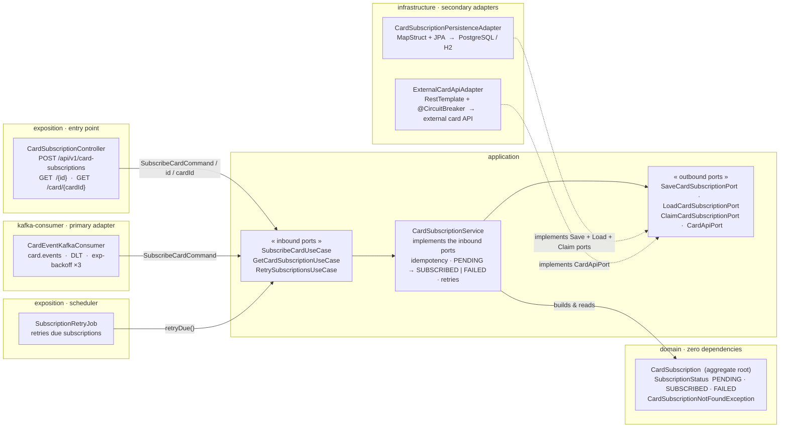
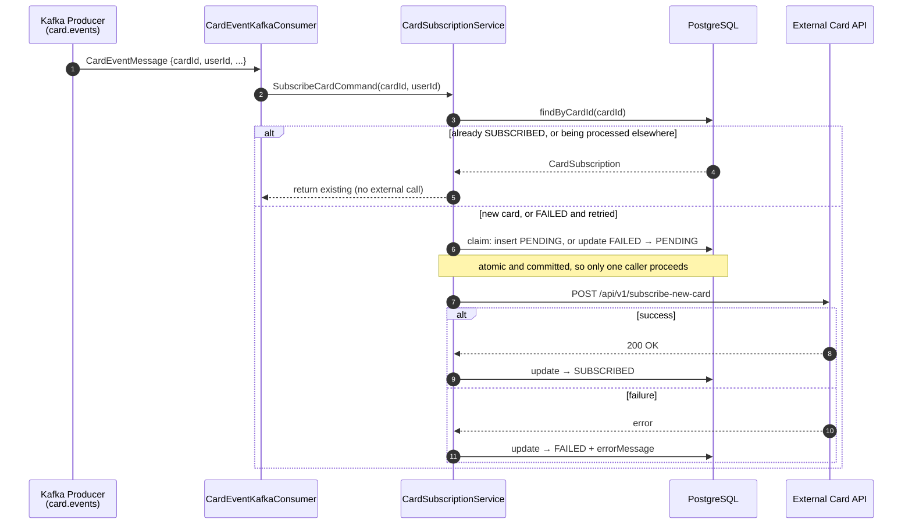
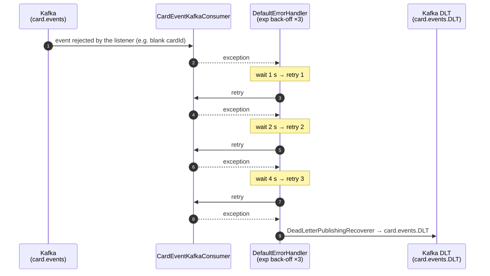

# Card Subscription Service


A Spring Boot demo microservice built with **DDD** and **Clean Architecture** principles, and load-tested for concurrency, overload and external failures.  
Consumes card events from Kafka, calls an external subscription API, and exposes a REST API to query results.

---

## Results at a glance

Load tests with k6 found nine defects in the first version. All are now fixed and re-measured:

| Measure | Before | After |
|---|---|---:|
| REST writes, 1 replica | 165 req/s | **418 req/s** |
| REST writes, 3 replicas | 476 req/s | **1,271 req/s**, no 5xx |
| Kafka events, 3 replicas | 38.7 events/s | **175 events/s**, one row per event across 72,000 events |
| 5 parallel requests for each of 200 cards | 991 rows | **200 rows** |
| Malformed Kafka message | Partition stopped | **Sent to the DLT**, next message processed |
| API hangs: slowest request | 19.9 s | **3.0 s** |
| Rows left `FAILED` after a 40 s outage | 2,015, never retried | **0**, within 5-7 minutes |


Measured on one laptop with 2 CPUs and 1 GB per replica and a stubbed 50 ms external API, so the ratios mean more than the absolute figures. The [full report](performance/README.md) has the method, every [finding](performance/README.md#findings) and the [limits that remain](performance/README.md#remaining-limits). The design decisions are in the [ADRs](docs/adr/README.md).

---

## Architecture

The project is a **Maven multi-module** application. Each module has a single, well-defined responsibility and a strict dependency direction — outer layers depend on inner layers, never the reverse.

```
┌─────────────────────────────────────────────────────────┐
│                        exposition                        │  ← Spring Boot entry point
│         REST controllers · DTOs · Converters            │
└──────────────┬──────────────────────────┬───────────────┘
               │                          │
┌──────────────▼──────────┐  ┌────────────▼──────────────┐
│     kafka-consumer      │  │       infrastructure       │
│  Listener · DLT · Config│  │  JPA Persistence · HTTP    │
└──────────────┬──────────┘  └────────────┬──────────────┘
               │                          │
        ┌──────▼──────────────────────────▼──────┐
        │               application               │
        │  Use cases (ports/in) · Services        │
        │  Outbound ports (ports/out)             │
        └──────────────────┬─────────────────────┘
                           │
                  ┌────────▼────────┐
                  │     domain      │  ← Zero dependencies
                  │  Model · Enums  │
                  │  Exceptions     │
                  └─────────────────┘
```

### Ports & Adapters



### Module breakdown

| Module           | Depends on                              | Responsibility                                              |
|------------------|-----------------------------------------|-------------------------------------------------------------|
| `domain`         | —                                       | `CardSubscription` aggregate, `SubscriptionStatus`, domain exceptions. Pure Java, no frameworks. |
| `application`    | `domain`                                | Use-case interfaces (`SubscribeCardUseCase`, `GetCardSubscriptionUseCase`), outbound port interfaces, `CardSubscriptionService`. |
| `infrastructure` | `application`                           | JPA entity, Spring Data repository, persistence adapter, Flyway migrations, external HTTP API adapter (RestTemplate + Resilience4j circuit breaker). |
| `kafka-consumer` | `application`                           | `CardEventKafkaConsumer`, `KafkaConsumerConfig` (DLT + exponential back-off), `CardEventMessage` DTO. |
| `exposition`     | `application` · `infrastructure` · `kafka-consumer` | `CardSubscriptionController`, `SubscriptionRetryJob`, request/response DTOs, converters, `GlobalExceptionHandler`, Spring Boot main class, Actuator/Prometheus endpoints. |

---

## Key Design Decisions

**Domain is framework-free.**  
`domain/pom.xml` has zero dependencies. `CardSubscription` uses a hand-written builder and plain getters/setters — it compiles with bare `javac`. No Lombok, no Spring, no JPA annotations leak into the domain.

**Kafka is isolated in its own module.**  
All messaging concerns (consumer config, DLT strategy, retry, Kafka DTOs) live exclusively in `kafka-consumer`. The rest of the application has no Kafka dependency. Swapping the messaging technology only touches this module.

**Converters are first-class citizens in exposition.**  
`CardSubscriptionResponseConverter` and `SubscribeCardRequestConverter` are dedicated `@Component` classes under `exposition/converter/`. The controller stays thin and delegates all mapping — both are independently unit-testable.

**One subscription per card.**  
A unique constraint on `card_id` means each card has one row, and a card is atomically claimed before the external API is called, so requests or events that arrive together make one call between them. Repeat calls return the current record: `SUBSCRIBED` when done, or `PENDING` while another call for that card is still in progress. Calling again after `FAILED` retries on the same row. The external API can still see a repeat if a call times out after it took effect, so it should also deduplicate by `cardId`.

**No database connection held during the external call.**  
Each step commits on its own, so a slow partner API does not exhaust the connection pool.

**Failed subscriptions are retried.**  
`SubscriptionRetryJob` retries `FAILED` rows with an exponential back-off (30 s, doubling) for up to 8 attempts, about an hour in total. It also completes `PENDING` rows abandoned by a crash once their 60 s lease expires. After the last attempt the row stays `FAILED` until the card is requested again.

**DLT with exponential back-off.**  
A message the listener rejects, such as a blank `cardId`, is published to `<topic>.DLT` via `DeadLetterPublishingRecoverer` after 3 retries (1 s → 2 s → 4 s). Each retry is logged with topic, partition, and offset. A message that is not valid JSON goes to the DLT immediately with its original bytes, so it cannot block its partition. External API failures do not use the DLT: they are recorded as `FAILED` and handled by the retry job.

**Circuit breaker on the external API.**  
`ExternalCardApiAdapter.subscribeCard()` is annotated with `@CircuitBreaker(name = "externalCardApi")`. The circuit opens when at least 50% of the last 10 calls fail or take longer than 2 s, measured from a minimum of 5 calls. While it is open, the fallback returns `false` and the subscription is immediately marked `FAILED` without calling the external API, and the retry job tries it again later. After 10 s the circuit goes half-open and allows 3 trial calls, closing if fewer than half of them fail. A 3 s read timeout bounds how long a hanging API can hold a request. State is shown at `/actuator/health` for information only: an open circuit does not mark the service unhealthy, so a partner outage does not get replicas restarted.

The reasoning and trade-offs behind these choices are recorded as [Architecture Decision Records](docs/adr/README.md).

---

## Subscription Flow

### Happy path (Kafka + REST)



> The REST path (`POST /api/v1/card-subscriptions`) follows the same service flow starting from step 2 — the controller converts the HTTP request into a `SubscribeCardCommand` and delegates to the same use case. The external call runs outside any transaction.

### Dead Letter Topic (DLT) — retry exhausted



> A message that is not valid JSON skips the retries: `ErrorHandlingDeserializer` hands it straight to the recoverer, and it reaches the DLT with its original bytes.

---

## Project Structure

```
card-subscription/
├── Dockerfile
├── docker/
│   └── docker-compose.yml          # Kafka + Zookeeper + Kafka UI + Postgres + App
├── docs/adr/                       # Architecture Decision Records
├── performance/                    # k6 load tests, results and report
├── domain/
│   └── src/main/java/.../domain/
│       ├── model/CardSubscription.java
│       ├── model/SubscriptionStatus.java
│       └── exception/CardSubscriptionNotFoundException.java
├── application/
│   └── src/main/java/.../application/
│       ├── command/SubscribeCardCommand.java
│       ├── port/in/SubscribeCardUseCase.java
│       ├── port/in/GetCardSubscriptionUseCase.java
│       ├── port/out/SaveCardSubscriptionPort.java
│       ├── port/in/RetrySubscriptionsUseCase.java
│       ├── port/out/LoadCardSubscriptionPort.java
│       ├── port/out/ClaimCardSubscriptionPort.java
│       ├── port/out/CardApiPort.java
│       ├── service/CardSubscriptionService.java
│       └── service/SubscriptionRetryPolicy.java
├── infrastructure/
│   ├── src/main/resources/db/migration/   (Flyway)
│   └── src/main/java/.../infrastructure/
│       ├── persistence/entity/CardSubscriptionEntity.java
│       ├── persistence/repository/CardSubscriptionJpaRepository.java
│       ├── persistence/adapter/CardSubscriptionPersistenceAdapter.java
│       ├── persistence/adapter/CardSubscriptionEntityMapper.java  (MapStruct)
│       ├── api/dto/SubscribeCardApiRequest.java
│       ├── api/dto/SubscribeCardApiResponse.java
│       ├── api/adapter/ExternalCardApiAdapter.java
│       └── config/RestTemplateConfig.java
├── kafka-consumer/
│   └── src/main/java/.../kafka/
│       ├── config/KafkaConsumerConfig.java
│       ├── dto/CardEventMessage.java
│       └── consumer/CardEventKafkaConsumer.java
└── exposition/
    └── src/main/java/.../
        ├── CardSubscriptionApplication.java
        └── exposition/
            ├── controller/CardSubscriptionController.java
            ├── scheduling/SubscriptionRetryJob.java
            ├── dto/request/SubscribeCardRequest.java
            ├── dto/response/CardSubscriptionResponse.java
            ├── converter/CardSubscriptionResponseConverter.java
            ├── converter/SubscribeCardRequestConverter.java
            ├── exception/GlobalExceptionHandler.java
            └── exception/ApiError.java
```

---

## Getting Started

### Prerequisites

- Java 21+
- Maven 3.9+
- Docker & Docker Compose

### 1. Run the full stack with Docker Compose

```bash
docker compose -f docker/docker-compose.yml up -d
```

This starts all services:

| Service     | Port  | Notes                                      |
|-------------|-------|--------------------------------------------|
| Zookeeper   | 2181  |                                            |
| Kafka       | 9092  | Internal broker address: `kafka:29092`     |
| Kafka UI    | 8090  | [http://localhost:8090](http://localhost:8090) |
| PostgreSQL  | 5432  | DB: `cardsubdb`, user: `carduser`          |
| App         | 8080  | Starts once Kafka is up and Postgres is healthy |

The app is built from the `Dockerfile` at the repo root (3-stage layered build — see below). Postgres data is persisted in the `postgres-data` Docker volume, and Flyway applies the schema at startup.

> **Upgrading an existing database:** migration `V2` deletes duplicate rows before adding the unique constraint, keeping one row per card (a `SUBSCRIBED` row if there is one, otherwise the most recent). Back up any data you need first.

### 2. Run locally (without Docker app container)

Start only the infrastructure:

```bash
docker compose -f docker/docker-compose.yml up -d zookeeper kafka kafka-ui postgres
```

Then build and run the application:

```bash
mvn clean package -DskipTests
java -jar exposition/target/exposition-*.jar
```

Or with Maven:

```bash
mvn spring-boot:run -pl exposition
```

The local profile uses **H2 in-memory** by default (`application.yml`). To point it at the Compose Postgres instead:

```bash
java -jar exposition/target/exposition-*.jar \
  --spring.datasource.url=jdbc:postgresql://localhost:5432/cardsubdb \
  --spring.datasource.username=carduser \
  --spring.datasource.password=cardpass \
  --spring.datasource.driver-class-name=org.postgresql.Driver
```

The application starts on **http://localhost:8080**.

### Dockerfile — 3-stage build

| Stage       | Base image                        | Purpose                                               |
|-------------|-----------------------------------|-------------------------------------------------------|
| `builder`   | `maven:3.9.6-eclipse-temurin-21`  | Compiles all modules, produces the fat jar            |
| `extractor` | `eclipse-temurin:21-jre`          | Splits the fat jar into 4 Spring Boot layers          |
| _(runtime)_ | `eclipse-temurin:21-jre`          | Copies layers in order; runs as non-root `appuser`    |

The layered JAR means a code-only change rebuilds only the thin **application** layer (~a few KB), leaving the 100 MB+ of dependencies untouched in the Docker cache.

---

## REST API

Base URL: `http://localhost:8080/api/v1/card-subscriptions`

### Subscribe a card

```http
POST /api/v1/card-subscriptions
Content-Type: application/json

{
  "cardId": "CARD-001",
  "userId": "USER-123"
}
```

The same request is safe to repeat. It returns the card's existing record, with `status` showing where it stands: `SUBSCRIBED`, `FAILED`, or `PENDING` if another call for this card is still in progress.

**Response `201 Created`:**  
```json
{
  "id": "a3f1c2d4-...",
  "cardId": "CARD-001",
  "userId": "USER-123",
  "status": "SUBSCRIBED",
  "requestedAt": "2024-05-10T10:00:00",
  "processedAt": "2024-05-10T10:00:01",
  "errorMessage": null
}
```

### Get subscription by ID

```http
GET /api/v1/card-subscriptions/{id}
```

### Get subscription by card ID

```http
GET /api/v1/card-subscriptions/card/{cardId}
```

### Error responses

All errors return a structured `ApiError` body:

```json
{
  "status": 404,
  "error": "Not Found",
  "message": "No subscription found for cardId: CARD-999",
  "timestamp": "2024-05-10T10:05:00",
  "details": []
}
```

---

## Kafka

### Topic consumed

| Topic         | Consumer group                        | DLT                  |
|---------------|---------------------------------------|----------------------|
| `card.events` | `card-subscription-consumer-group`    | `card.events.DLT`    |

### Message format (`CardEventMessage`)

```json
{
  "eventId": "evt-001",
  "eventType": "CARD_CREATED",
  "cardId": "CARD-001",
  "userId": "USER-123",
  "eventTimestamp": "2024-05-10T10:00:00"
}
```

### Produce a test event

```bash
docker exec -it kafka kafka-console-producer \
  --broker-list localhost:9092 \
  --topic card.events
```

Then paste:
```json
{"eventId":"evt-001","eventType":"CARD_CREATED","cardId":"CARD-001","userId":"USER-123","eventTimestamp":"2024-05-10T10:00:00"}
```

---

## Configuration

Key properties in `exposition/src/main/resources/application.yml`:

| Property                            | Default                        | Description                          |
|-------------------------------------|--------------------------------|--------------------------------------|
| `server.port`                       | `8080`                         | HTTP port                            |
| `spring.kafka.bootstrap-servers`    | `localhost:9092`               | Kafka broker address                 |
| `spring.kafka.consumer.group-id`    | `card-subscription-consumer-group` | Consumer group ID                |
| `kafka.topics.card-events`          | `card.events`                  | Source topic                         |
| `kafka.topics.card-events-partitions` | `12`                         | Partitions created for the topic and its DLT |
| `spring.kafka.listener.concurrency` | `4`                            | Listener threads per replica         |
| `external.card-api.base-url`        | `http://localhost:8081`        | External subscription API base URL   |
| `external.card-api.subscribe-path`  | `/api/v1/subscribe-new-card`   | Subscription API endpoint path       |
| `external.card-api.read-timeout`    | `3s`                           | Longest wait for the external API (`connect-timeout`: `2s`) |
| `card-subscription.retry.enabled`   | `true`                         | Runs the retry job                   |
| `card-subscription.retry.max-attempts` | `8`                         | Attempts before a row stays `FAILED` |
| `card-subscription.retry.initial-delay` | `30s`                      | First retry delay; doubles each time, up to `max-delay` (`30m`) |
| `card-subscription.retry.pending-lease` | `60s`                      | When a `PENDING` row counts as abandoned |
| `management.endpoints.web.exposure.include` | `health,info,prometheus,metrics` | Exposed Actuator endpoints |
| `resilience4j.circuitbreaker.instances.externalCardApi.failure-rate-threshold` | `50` | % failures to open circuit |
| `resilience4j.circuitbreaker.instances.externalCardApi.wait-duration-in-open-state` | `10s` | Time before half-open retry |

Override any property via environment variable using Spring's relaxed binding, e.g.:

```bash
SPRING_KAFKA_BOOTSTRAP_SERVERS=kafka:9092 java -jar app.jar
```

---

## Running Tests

```bash
# Unit tests only — no Docker required
mvn test -pl exposition -Dtest="**/unit/**"

# Integration tests — requires Docker (Testcontainers starts Postgres + Kafka automatically)
mvn test -pl exposition -Dtest="**/integration/**"

# All tests — requires Docker
mvn test
```

Integration tests use [Testcontainers](https://testcontainers.com/) — no manual `docker compose up` needed.

**Windows with Docker Desktop 4.28+:** named pipes return HTTP 400; use the TCP endpoint instead.

1. Enable **"Expose daemon on tcp://localhost:2375 without TLS"** in Docker Desktop → Settings → General.
2. Create `~/.testcontainers.properties` **without a UTF-8 BOM** (PowerShell 5):

```powershell
$enc = New-Object System.Text.UTF8Encoding $false
[System.IO.File]::WriteAllText("$env:USERPROFILE\.testcontainers.properties",
    "docker.host=tcp://127.0.0.1:2375`n", $enc)
```

---

## Observability

| Endpoint | Description |
|---|---|
| `GET /actuator/health` | Application + circuit-breaker health |
| `GET /actuator/prometheus` | Prometheus-format metrics (Micrometer) |
| `GET /actuator/metrics` | JVM, HTTP, Kafka, and custom metrics |

The circuit breaker state (`externalCardApi`) is exposed in both `/actuator/health` and `/actuator/prometheus` so it can be scraped by Prometheus and displayed in Grafana. An open circuit shows as `CIRCUIT_OPEN` in the health details, but overall health stays `UP`.

---

## Tech Stack

| Layer        | Technology                                           |
|--------------|------------------------------------------------------|
| Language     | Java 21                                              |
| Framework    | Spring Boot 3.2.5                                    |
| Messaging    | Spring Kafka 3.x, `DefaultErrorHandler`, DLT         |
| Persistence  | Spring Data JPA, Flyway, H2 (dev), PostgreSQL        |
| Mapping      | MapStruct 1.5.5 (infrastructure only)                |
| Resilience   | Resilience4j 2.1 — circuit breaker on external API   |
| Observability| Spring Actuator, Micrometer, Prometheus              |
| Testing      | Testcontainers (Postgres + Kafka), Mockito `@MockBean`, Awaitility |
| Build        | Maven 3.9, multi-module                              |
| Container    | Docker (multi-stage build, non-root user)            |
